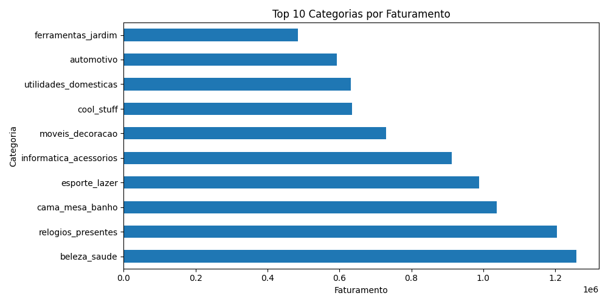
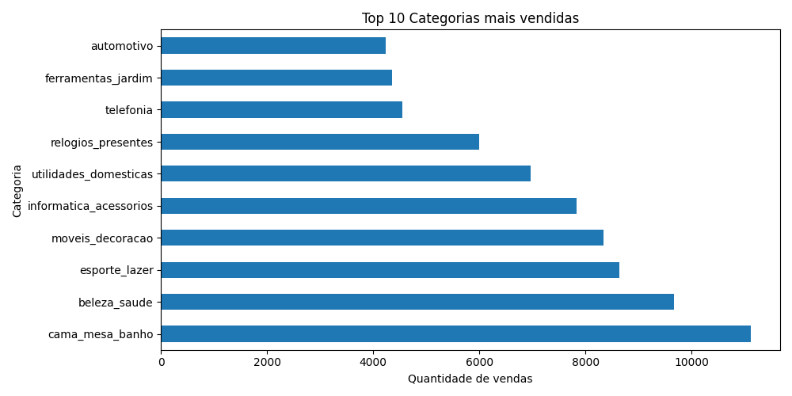
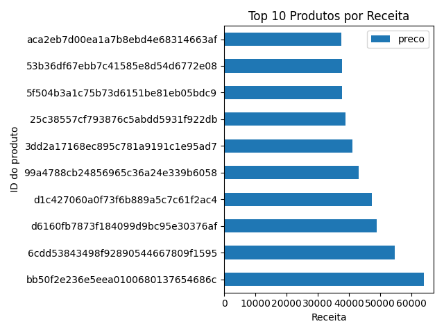
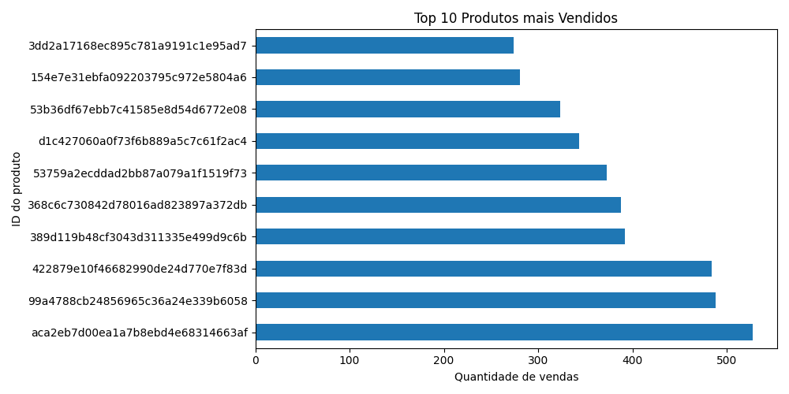
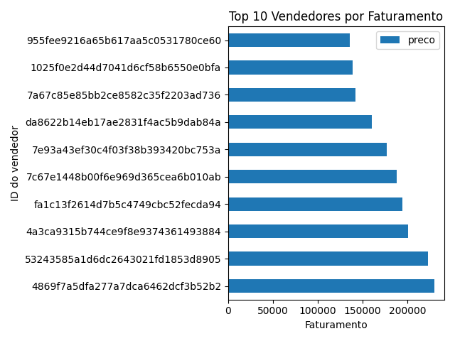
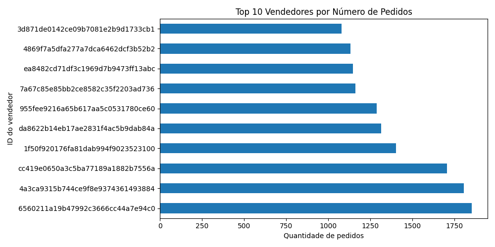
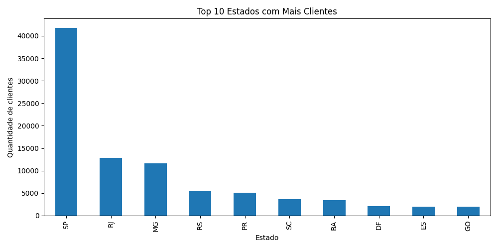
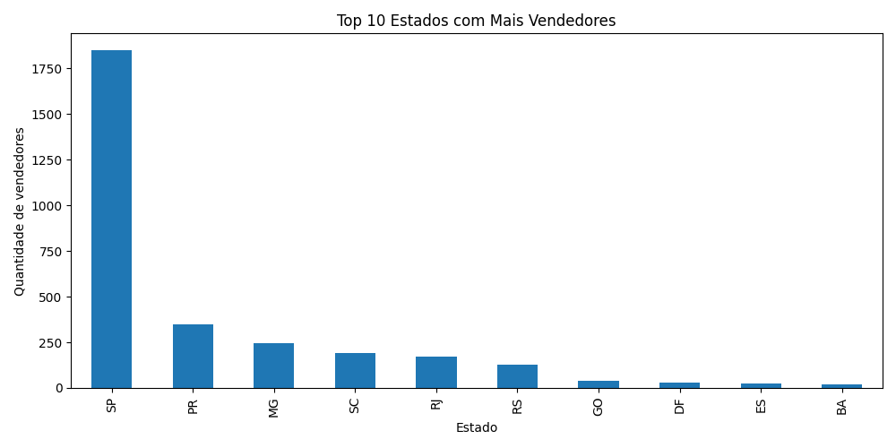
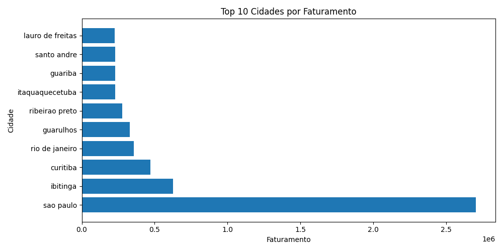
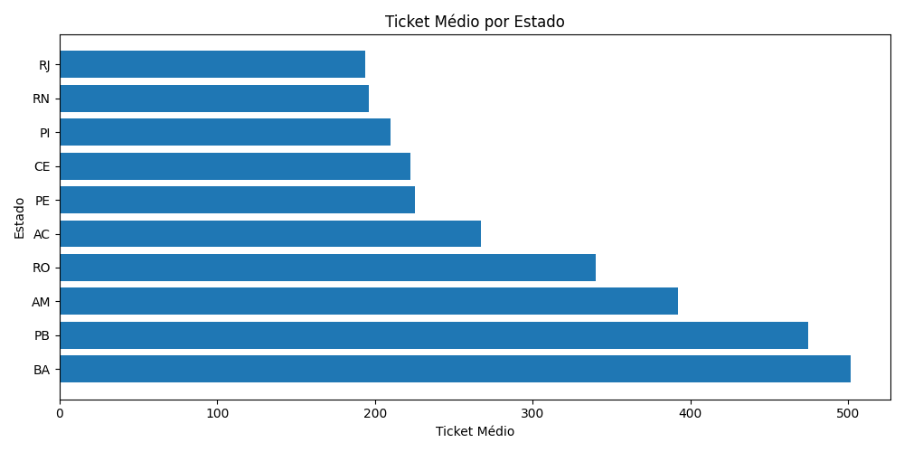

# 📊 pipeline-simples-de-analise-ecommerce-pandas

Projeto de análise de dados utilizando Python e Pandas com base em dados de e-commerce.  
O objetivo do projeto foi tratar os dados, criar KPIs, gerar visualizações e organizar os resultados em uma estrutura mais próxima de projetos reais de dados.

---

# 🚀 Objetivos do Projeto

Realizar análises de negócio utilizando dados de:

- Clientes
- Pedidos
- Produtos
- Pagamentos
- Vendedores
- Localização

Respondendo perguntas como:

- Quais categorias mais faturam?
- Quais produtos mais geram receita?
- Quais vendedores possuem maior faturamento?
- Quais cidades mais faturam?
- Qual o ticket médio por estado?
- Como clientes e vendedores estão distribuídos?

---

# 🛠 Tecnologias Utilizadas

- Python
- Pandas
- Matplotlib
- Git
- GitHub

---

# 📂 Estrutura do Projeto

```text
projeto/
│
├── data/
│   ├── raw/                  # Dados brutos
│   ├── processed/            # Dados tratados
│   └── database/             # Pasta reservada para uso futuro com banco de dados
│
├── outputs/
│   ├── tabelas/              # KPIs exportadas em CSV
│   └── graficos/             # Gráficos gerados
│
├── src/
│   ├── extract.py            # Extração/leitura dos dados
│   ├── transform.py          # Tratamento dos dados
│   ├── analysis_pandas.py    # KPIs e gráficos
│   ├── load.py               # Salvamento de outputs
│   └── main.py               # Execução principal
│
├── requirements.txt
└── README.md
```

---

# 📈 KPIs Analisadas

## KPIs Gerais

- Faturamento total
- Número total de pedidos
- Ticket médio
- Quantidade de produtos vendidos

---

## Clientes

- Distribuição de pedidos por cliente
- Estados com mais clientes

---

## Produtos e Categorias

- Categorias mais vendidas
- Categorias com maior faturamento
- Produtos mais vendidos
- Produtos que mais geram receita

---

## Vendedores

- Vendedores com mais pedidos
- Vendedores com maior faturamento
- Estados com mais vendedores

---

## KPIs Avançadas

- Top 10 cidades com maior faturamento
- Ticket médio por estado

---

# 📊 Visualizações
## 📌 Top Categorias por Faturamento



---

## 📌 Top Categorias Mais Vendidas



---

## 📌 Top Produtos por Receita



---

## 📌 Top Produtos Mais Vendidos



---

## 📌 Top Vendedores por Faturamento



---

## 📌 Top Vendedores por Pedidos



---

## 📌 Estados com Mais Clientes



---

## 📌 Estados com Mais Vendedores



---

## 📌 Top Cidades por Faturamento



---

## 📌 Ticket Médio por Estado



---
---

O projeto também conta com gráficos utilizando Matplotlib:

- Top categorias por faturamento
- Top categorias mais vendidas
- Top produtos por receita
- Top produtos mais vendidos
- Top vendedores por faturamento
- Top vendedores por pedidos
- Estados com mais clientes
- Estados com mais vendedores
- Top cidades por faturamento
- Ticket médio por estado

---

# 🧠 Principais Aprendizados

Durante o projeto foram praticados conceitos importantes de análise de dados:

- Leitura e tratamento de dados com Pandas
- Criação de KPIs
- Uso de `groupby`
- Uso de `merge`
- Uso de `value_counts`
- Uso de `nunique`
- Criação de gráficos
- Modularização do projeto
- Organização de estrutura de pastas
- Separação entre:
  - dados brutos
  - dados tratados
  - outputs
- Salvamento de tabelas e gráficos
- Entendimento de granularidade dos dados

---

# 📌 Insights Encontrados

- O dataset apresenta baixa recorrência de clientes, indicando que a maioria realizou apenas um pedido.
- Algumas categorias possuem alto volume de vendas, mas não necessariamente maior faturamento.
- Produtos mais vendidos não são sempre os produtos que mais geram receita.
- Alguns vendedores concentram grande parte do faturamento total.
- Certos estados possuem ticket médio significativamente maior.

---

# ▶️ Como Executar

## 1. Clonar o repositório

```bash
git clone git@github.com:GabrielRicardoA/pipeline-simples-de-analise-ecommerce-pandas.git
```

---

## 2. Entrar na pasta do projeto

```bash
cd pipeline-simples-de-analise-ecommerce-pandas
```

---

## 3. Instalar as dependências

```bash
pip install -r requirements.txt
```

---

## 4. Executar o projeto

```bash
python src/main.py
```

---

# 📦 Dependências

```txt
pandas
matplotlib
```

---

# 📁 Outputs Gerados

## Dados Tratados

Os datasets tratados são armazenados em:

```text
data/processed/
```

---

## Tabelas/KPIs

As KPIs exportadas em CSV são armazenadas em:

```text
outputs/tabelas/
```

---

## Gráficos

Os gráficos gerados são armazenados em:

```text
outputs/graficos/
```

---

# 👨‍💻 Autor

Gabriel Araújo

GitHub: https://github.com/GabrielRicardoA